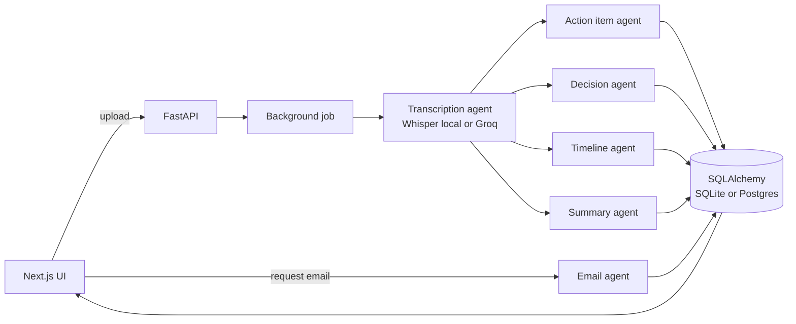

# Meeting Intelligence Engine

> Upload a meeting recording and get back a timestamped transcript, a short summary, action items with owners and due dates, key decisions, a topic timeline and a follow-up email draft.

[](https://github.com/Jai-Negi/meeting-intelligence/actions/workflows/backend-tests.yml) [](https://github.com/Jai-Negi/meeting-intelligence/actions/workflows/frontend-checks.yml)     

<!-- Demo: add a short GIF of uploading a recording and the results page, e.g. docs/demo.gif -->

## Why I built it

Nobody wants to rewatch an hour-long call to remember who agreed to do what. I wanted a project that goes beyond a single LLM call and deals with real production concerns: background jobs, failure recovery, swappable providers, tests and CI.

## Features

- **Transcription** with timestamped segments, using Whisper locally or Groq's hosted Whisper
- **Meeting summary** with a short overview and the key points raised
- **Action items** with owner and due date, **key decisions** and a **topic timeline**, each extracted by its own specialised agent
- **Follow-up email draft** generated on demand, ready to edit and copy
- **Concurrent extraction:** the four analysis agents run in parallel with `asyncio.gather`
- **Reliable by design:** a shared agent base class handles retries, exponential backoff with jitter, timeouts, and separates permanent errors from retryable ones, so one failing agent doesn't break the whole job
- **Swappable providers with fallback:** Groq, Anthropic or a local Ollama model for the LLM, and local or Groq Whisper for transcription, all chosen by configuration. If the main LLM provider fails, the configured fallbacks are tried in order
- **Meeting history:** browse past meetings, retry failed jobs and delete old ones from the Next.js UI

## How it works



Each agent is a single-purpose step in a fixed pipeline. They share one base class, so retry and timeout behaviour is consistent and tested once.

## Tech stack

| Area | Technologies |
|---|---|
| Backend | Python 3.11, FastAPI, Pydantic, SQLAlchemy, Alembic |
| LLMs | Groq, Anthropic, Ollama (selected via `LLM_PROVIDER`) |
| Transcription | OpenAI Whisper (local) or Groq Whisper (hosted) |
| Frontend | Next.js, React, TypeScript, Tailwind CSS |
| Quality | pytest, GitHub Actions, ESLint, TypeScript checks, Dependabot |
| Deployment | Docker (full image with local Whisper, slim hosted image without torch) |

## Quick start

```bash
git clone https://github.com/Jai-Negi/meeting-intelligence.git
cd meeting-intelligence
cp backend/.env.example backend/.env   # add your Groq or Anthropic key
docker compose -f docker/docker-compose.yml up --build
```

The API runs at http://localhost:8000 (interactive docs at `/docs`). Then start the UI:

```bash
cd frontend
npm install
npm run dev
```

Open http://localhost:3000. Set `NEXT_PUBLIC_API_URL` if the API runs somewhere other than port 8000.

### Run without Docker

```bash
cd backend
python -m venv .venv && source .venv/bin/activate
pip install -r requirements.txt
uvicorn app.main:app --reload
```

## Configuration

| Variable | Options | Purpose |
|---|---|---|
| `LLM_PROVIDER` | `groq`, `anthropic`, `ollama` | Model used for extraction and emails |
| `LLM_FALLBACK_PROVIDERS` | comma separated, e.g. `anthropic,ollama` | Providers to try in order if the main one fails |
| `TRANSCRIPTION_PROVIDER` | `local`, `groq` | Where Whisper runs |
| `GROQ_API_KEY` / `ANTHROPIC_API_KEY` | | Keys for hosted providers |
| `OLLAMA_BASE_URL` | | Local Ollama server |
| `MAX_UPLOAD_SIZE_MB` | default 500 | Upload limit (capped at 25 MB when using Groq Whisper) |
| `DATABASE_URL` | SQLite or Postgres URL | Storage |

See `backend/.env.example` for the full list.

## API

| Method | Endpoint | Purpose |
|---|---|---|
| POST | `/meetings/upload` | Upload a recording and start processing |
| GET | `/meetings/{job_id}` | Get the transcript and extracted results |
| GET | `/meetings` | List past meetings |
| POST | `/meetings/{job_id}/retry` | Retry a failed job |
| POST | `/meetings/{job_id}/email` | Generate a follow-up email draft |
| DELETE | `/meetings/{job_id}` | Delete a meeting and its recording |

## Testing and CI

```bash
cd backend
pip install -r requirements-dev.txt
python -m pytest tests/
```

- **158 backend tests** covering the agent base class (retries, backoff, timeouts), each agent, the LLM and Whisper tools, validators, upload limits and every API route
- **Backend CI** runs the full suite twice: once with local Whisper installed, and once on the slim hosted install to confirm it works without torch
- **Frontend CI** runs a type check, lint and production build on every push
- **Dependabot** keeps Python and npm dependencies up to date

## What I learned

- Separating retryable errors (rate limits, timeouts, 5xx) from permanent ones (bad requests, auth failures) saves wasted calls and gives clearer failure messages
- Running the four independent analysis agents concurrently means a job waits for the slowest agent, not all four in sequence
- Shipping two Docker images, one with local Whisper and a slim one using Groq, kept the hosted image several GB smaller

## Roadmap

- A bot that joins meetings live instead of working from recordings
- Speaker identification in transcripts
- Export of action items to task tools

## License

MIT
